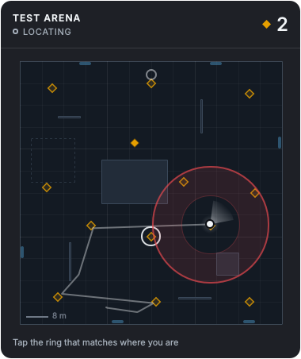

# DeadByMapper

A glanceable **live minimap companion for Dead by Daylight** (Windows). Outside a trial it shows a
dashboard: game link, sensor health, calibration, map library. In a trial it shows a small
always-on-top pane:

- **where you are**: a dot with a heading cone; the halo shows how sure it is;
- **where the generators are** and which one to do next (it avoids leaving a 3-gen);
- **where the exit gates are**;
- **how close the killer is**: a ring from the heartbeat (later milestone).

It is built to help you *learn maps*: loops, tile layouts, and generator spacing ("near vs far"
gens is about how close the gens are to each other, the 3-gen, not about the exit gates).



## Status: v0.1 scaffold (milestone M0)
| Works now | Needs your PC / later milestones |
|---|---|
| `--demo`: a simulated survivor and killer on a test map drive the full pipeline and UI | Sensors verified on real hardware (M1) |
| Localization engine (particle filter + global path matching), benchmarked in simulation | Calibration wizard (M2) |
| Dashboard + minimap pane (PySide6/QML), crisp at 1x/2x | Automatic match / map / interaction detection from the screen (M3) |
| Game link: process, window, log tail, ini reader (tested with fakes) | Real map layouts: an editor plus verified maps (M4) |
| F9 / F10 / F8 hotkey marks: generator / exit gate / note (logic tested; hardware check in M1) | Heartbeat ring from live audio (M6) |
| Record and replay of sessions | Gen states, gates on sight, live tile discovery (M8) |
| PyInstaller build, installer and Desktop shortcut scripts | First real exe build on your PC (M1) |

## Quick start (Windows 11)
```powershell
cd C:\dev\DeadByMapper
powershell -ExecutionPolicy Bypass -File scripts\bootstrap.ps1     # uv, Python 3.12, deps, tests
uv run python -m deadbymapper --demo                               # see it work without the game
powershell -ExecutionPolicy Bypass -File packaging\build.ps1       # exe + install + Desktop shortcut
```
Play DBD in **Windowed Fullscreen**. Overlays can't draw over exclusive fullscreen; a second monitor
also works.

## Fair play (read docs/FAIR_PLAY.md)
DeadByMapper only observes what you already perceive:
- your screen;
- the audio you hear;
- your own keyboard and mouse (gated so it never records keys typed in other apps);
- the log and config files the game writes.

It never:
- reads or writes game memory, injects code, hooks DirectX or sniffs packets;
- automates input;
- shows anything you couldn't perceive yourself.

That is the same pattern as tolerated overlay tools. It is still third-party software, and Behaviour
Interactive alone decides what counts as an unfair advantage, so **use it at your own risk**. It
works best as a learning tool in custom games and Kill Your Friends.

## For developers and AI agents
- `CLAUDE.md`: the operating manual (rules, commands, lanes, gotchas).
- `docs/AGENT_KICKOFF_PROMPT.md`: the prompt for the lead agent.
- `docs/`:
  - ARCHITECTURE, LOCALIZATION, MAP_SPEC, MAP_DETECTION, UI_DESIGN, AUDIO_HEARTBEAT;
  - ROADMAP, TESTING, DATA_COLLECTION, HANDOFF, DECISIONS;
  - RESEARCH, FAIR_PLAY;
  - `adr/`.
- `.claude/agents/`: nine specialist subagents (Opus, high effort), one per lane.

```
src/deadbymapper/   core · config · gamelink · capture · input · perception · audio · localization · world · recording · sim · ui
data/               maps (47 stubs + Test Arena) · game facts (speeds, terror radius, keybinds, rules) · schemas
tools/              bench_localization · validate_maps · gen_map_stubs · gen_schemas · log_probe · recording_info · make_icon
packaging/ scripts/ tests/ docs/
```

Proprietary - Goob Entertainment Co. Dead by Daylight is a trademark of Behaviour Interactive Inc.
This project is not affiliated with or endorsed by Behaviour Interactive.
